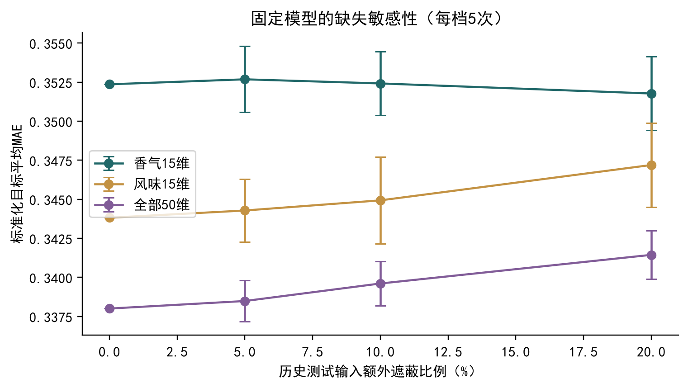
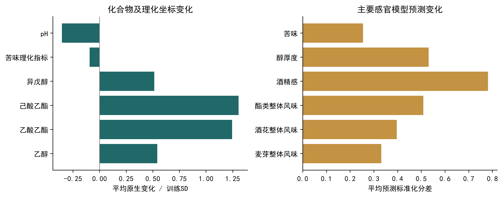

# 啤酒感官预测、稳定关联与局部风格谱生成

候选提交版 v3｜原始评分校准及部分缺陷判据仍待确认。

## 摘要

针对250款啤酒的混合尺度化学与感官数据，构建连续预测、关联分析和局部风格生成流程。冻结模型在香气15维、风味15维及全部50维的测试MAE分别为0.3524、0.3438和0.3380；全50维较均值基准改善17.97%。原始评分逆变换缺少依据，另提供明确标注的相对七级。第二问保留150条Top-3关联，其中19条同时满足80%入选频率与风格调整同向。第三问生成22风格共2200条谱，局部插值存在方差收缩；11款Pils/Lager向Tripel的候选修改均缩小设定距离，但这不是独立的风格迁移验证。四缺陷原生值冻结，Stale hops仅施加弱模型代理约束。

关键词：感官预测；相对等级；Spearman关联；局部条件生成；约束优化。

## 1 问题与数据

赛题要求感官分级、化合物–风味分析及风格条件谱生成[1]。附件1实际含250款、231个化学或理化输入；附件4含50个连续感官目标。评分卡的Aroma和Flavour各15维，本文将两组作为第一问主体，全50维作为扩展；“约40维”的题面口径仍待确认。化学谱与感官数据的关联建模已有公开研究[2]，本文不把其结果当作本项目实验结果。

以唯一beer编号一一对齐，排除beer_id和风格标签作为第一问输入。条码在附件4存在精度损失，不作为连接键。按风格分层、随机种子42固定200/50训练与测试划分；风格只在分层和第三问条件分组中使用。测试集已在历史工作中查看，本轮不再调参，不能称为新的盲测。训练内OOF也受既有CV选择影响，不作无偏嵌套评估。

附件1混合原值与对数尺度。经附件8正值配对核实，DMS及4VG分别249和82个正值对应log10，误差小于5×10^-10；单位声明分别为μg/L和mg/L。两列附件8的1和168个零值对应有限替代码，含义未获检测记录确认。双乙酰241条共同有效值中238条原值匹配；beer156、34、151存在差异，另9处附件1缺失而附件8为0。beer73两份均约121.731018 mg/L，保留该值并标记真实性待核查。反式-2-壬烯醛有2处数值冲突、1处缺失状态差异，阈值未提供。不据异常或缺失删样本，不将未知记为0。

原始评分卡除Beer#外相同，汇总为空白模板。附件4、7及公开补充表[3]没有提供可验证的完整原始评分与逆变换参数。即使假设z=(r-μ)/σ，未知μ、σ也不能唯一恢复原始r；相对分级、标准化预测和原始0–6强度是三个不同对象。

## 2 第一问：方法

记训练化学输入为x_i，附件4目标为z_it，t为感官维度。每个目标沿用冻结训练CV选择：42个随机森林、5个岭回归、3个训练均值预测器。均值基准为训练子集的目标均值；岭回归最小化Σ_i(z_it-b-x_i^Tβ)^2+100‖β‖^2；森林预测为200棵回归树预测的平均，最大深度6、叶节点最少5样本、每次分裂候选特征比例0.7。参数及目标级选择来自已冻结历史训练CV，不根据本轮测试结果更新。

森林只用训练列中位数填补。岭回归先按训练列1%–99%分位数裁剪，再以训练中位数填补并标准化。5折OOF的每次处理只在对应160款拟合集估计；最终模型仅在200款训练集拟合。记录并核对各次填补、裁剪、均值和方差，避免用全体数据预处理。

相对等级使用训练子集六个界点q_tj=Q_t(j/7)，j=1,…,6，定义g_t(z)=Σ_j I(z≥q_tj)。预测与观测标签使用同一套训练界点；边界相等进入较高档。OOF界点按折计算，测试界点仅来自200款训练数据。该0–6编码表示相对位置，不是原始强度还原。

连续MAE、等级MAE和七档准确率分别为平均|z-z_hat|、平均|g-g_hat|和平均I(g=g_hat)。各维等权汇总；报告Aroma、Flavour、全50维，不因单项结果差而剔除。额外缺失试验在固定测试输入上随机遮蔽0%、5%、10%、20%，每档5次，使用相同模型；它仅模拟MCAR缺失，不代表真实缺失机制。

## 3 第一问：结果

| 数据 | 维度 | 基准MAE | 模型MAE | 改善% |
| --- | --- | --- | --- | --- |
| 训练OOF | 香气15维 | 0.4102 | 0.3650 | 11.0150 |
| 训练OOF | 风味15维 | 0.4173 | 0.3566 | 14.5542 |
| 训练OOF | 全部50维 | 0.4188 | 0.3442 | 17.7973 |
| 历史测试 | 香气15维 | 0.3929 | 0.3524 | 10.3123 |
| 历史测试 | 风味15维 | 0.4064 | 0.3438 | 15.3926 |
| 历史测试 | 全部50维 | 0.4120 | 0.3380 | 17.9664 |

| 维度 | 基准等级MAE | 模型等级MAE | 基准准确率% | 模型准确率% |
| --- | --- | --- | --- | --- |
| 香气15维 | 1.7227 | 1.5293 | 17.7333 | 18.1333 |
| 风味15维 | 1.7947 | 1.4933 | 16.0000 | 21.0667 |
| 全部50维 | 1.8420 | 1.5420 | 15.8000 | 20.4400 |

全50维中42维改善。下表保留全部未优于基准的维度；正改善率表示误差下降，负值表示退化。相对七级的全50维准确率仅20.44%，不能由连续MAE改善推断七级区分已充分解决。

| 维度代码 | 基准MAE | 模型MAE | 改善% | 说明 |
| --- | --- | --- | --- | --- |
| A_malt_grain | 0.3435 | 0.3735 | -8.7246 | 差于基准 |
| F_hops_citrus | 0.3267 | 0.3534 | -8.1509 | 差于基准 |
| A_hops_woody | 0.2144 | 0.2311 | -7.7790 | 差于基准 |
| A_malt_bread | 0.3375 | 0.3470 | -2.8149 | 差于基准 |
| metallic | 0.4000 | 0.4035 | -0.8753 | 差于基准 |
| F_malt_grain | 0.3086 | 0.3086 | 0.0000 | 等于基准 |
| stale_hops | 0.3041 | 0.3041 | 0.0000 | 等于基准 |
| barnyard | 0.3233 | 0.3233 | 0.0000 | 等于基准 |

完整维度结果、七档观测/预测/基准和界点随支撑材料提供。原始强度评分需要主办方提供校准信息；本文没有对标准化值进行min-max或平移后冒称还原。

## 4 第二问：关联网络与因素

按附件8名称映射完整覆盖231项。对26565个不同指标对，附件2与附件1重算Spearman的最大差6.66×10^-16，Pearson平均差约0.0877；据数值证据按Spearman处理，并保留Pearson敏感性表。候选排除4个汇总、5个整体理化、4个混合定义项，保留218项单项化学测量；实际化学分类只在公开补充表有唯一名称匹配时引用[3]。

对每个感官目标按成对有效样本计算Spearman，要求不少于200个，按绝对相关取前三。对整行beer重采样200轮，每轮在全部218个候选中重新排名，入选频率f等于进入Top-3次数/200。风格调整在共同有效样本的全局秩上减去各风格组均值，再计算残差相关；它只去除组间平均秩差，不消除全部混杂。

网络以|ρ|≥0.6连边，含218节点、245边；100轮边重采样另标识稳定边。网络仅作为共变与共线性解释、可视化背景，没有参与Top-3筛选或重新加权。150条结果分为19条稳定且方向一致、124条排名不稳定、7条风格调整后反向；反向标记优先展示，所有原Top-3保留。80%阈值是展示规则，不是因果概率。

## 4.1 化学解释与反证

| 感官 | 第一关联候选 | 原始ρ | 入选频率 | 调整ρ | 类型 |
| --- | --- | --- | --- | --- | --- |
| 麦芽整体香气 | Acetaldehyde | 0.3612 | 0.6000 | 0.0320 | 排序不稳定 |
| 酒花整体香气 | Ethyl octanoate | 0.4637 | 0.7900 | 0.2868 | 排序不稳定 |
| 酯类整体香气 | N-hexanol | 0.3569 | 0.7500 | 0.2747 | 排序不稳定 |
| 香蕉类酯风味 | N-hexanol | 0.3054 | 0.7650 | 0.2239 | 排序不稳定 |
| DMS感知 | Terpinen-4-ol | -0.1955 | 0.2300 | -0.1710 | 排序不稳定 |
| 4VG感知 | 4-vinylguaiacol | 0.4726 | 0.9000 | 0.4344 | 稳定关联 |
| 反式-2-壬烯醛感知 | Beta-phellandrene | -0.2140 | 0.3050 | -0.1860 | 排序不稳定 |
| 双乙酰感知 | Eugenol | -0.3232 | 0.6300 | -0.2614 | 排序不稳定 |

甲基吡嗪在麦芽整体香气的Top-3中，Malt来源只是机制线索；乙醇与该目标的相关在调整风格后反向，因此不能据此宣称乙醇增加麦芽香。酒花整体香气的Top-3包含酵母相关酯及陈化醛，三者中有1/3对达到网络连边强度，支持共同变化而非三个独立致味效应的解释。

4VG与其同名感官目标具有实体对应关系，但不能忽略零值替代码和基质效应。DMS、双乙酰和反式-2-壬烯醛的第一候选没有形成高稳定的同名对应，表中的弱结果同样保留。入选频率低或调整后反向的项目只作探索性线索，不建议据统计排名直接添加化合物。完整150条包括名称、单位、来源、化学分类证据、频率、调整相关与网络背景。

## 5 第三问：局部条件生成

对风格s的训练集D_s，先均匀抽锚点i，再从同风格最近的k=min(5,n_s-1)个样本中均匀抽j，采样λ~Beta(1,4)，生成x_new=(1-λ)x_i+λx_j。近邻距离采用训练中位数填补和训练StandardScaler后的231维空间。生成使用原生坐标；任一父样本缺失则生成坐标保留缺失，保存父样本编号与λ。不把该局部核插值包装为深度生成网络。

每风格生成100条，共2200条，输入冻结感官模型得到画像。对照为同风格直接重采样和无条件局部生成，方法与参数固定。距离统一为全局训练尺度上的RMS欧氏距离，并另外报告到同风格训练集的距离。方差使用观测原生值、ddof=1，再除以全局训练尺度平方；生成/训练方差比只在训练方差大于10^-12且生成方差可用的共同列上求比。留出数不足2时方差为NA。

经验覆盖半径r_s取同风格训练点留一最近邻距离的95%分位数；留出点到100条生成谱的最近距离≤r_s即记覆盖。该有限样本指标不是95%置信保证。重复率以到任一训练点的RMS距离<10^-10定义。所有计算都不用于重新选模型或调参。

## 5.1 生成结果与局限

| 风格 | 方法 | 训练数 | 留出数 | 方差比 | 同风格训练距离 | 留出覆盖 |
| --- | --- | --- | --- | --- | --- | --- |
| Kriek | 条件局部 | 8 | 2 | 0.6430 | 0.2228 | 1.0000 |
| Kriek | 条件重采样 | 8 | 2 | 0.8248 | 0.0000 | 1.0000 |
| Kriek | 无条件局部 | 8 | 2 | 0.8493 | 1.1678 | 1.0000 |
| Lambic | 条件局部 | 9 | 2 | 0.5728 | 0.2045 | 1.0000 |
| Lambic | 条件重采样 | 9 | 2 | 0.8927 | 0.0000 | 1.0000 |
| Lambic | 无条件局部 | 9 | 2 | 1.2212 | 1.1456 | 1.0000 |
| Tripel | 条件局部 | 22 | 6 | 0.7427 | 0.1628 | 1.0000 |
| Tripel | 条件重采样 | 22 | 6 | 0.7811 | 0.0000 | 1.0000 |
| Tripel | 无条件局部 | 22 | 6 | 0.8376 | 0.8947 | 1.0000 |

22种风格等权平均，局部生成方差比0.5985，重采样为0.8192；留出覆盖分别0.7197和0.7197，未显示覆盖优势。条件局部谱没有精确复制训练向量，但明显靠近训练支持，不能据此宣称新颖性或全分布覆盖。全22风格结果和缺失率另表提供。

训练拟合的风格诊断器在历史测试集准确率60.0%，生成条件一致率98.95%。高生成一致率与接近训练供体有关，不是实测味道证据。画像的生成分位数只描述模型内变化，不包含全部预测误差。

总酯、总酸、酒花香气、硫化合物及热量的完整组分清单、系数、单位和变换链未获证实，五项一致性均为“未验证”；不猜公式重算。统计谱范围内不等于物理配方守恒或酿造工艺可行。

## 6 Pils/Lager向Tripel的受约束修改

对11款Pils/Lager，供体限于训练Tripel，枚举α∈{0,0.25,0.5,0.75}的原生插值，加入原谱作为不修改候选。源缺失不补全，DMS、双乙酰、4VG、反式-2-壬烯醛恢复为源原生值。候选至少保留25%源坐标；这里的系数不是实际酿造体积比例。

令z为训练拟合的填补/标准化表示，d_T(z)为到Tripel训练谱的最小RMS距离，选择使d_T(z_new)+0.1‖z_new-z_source‖/√231最小的可行候选。额外要求Stale hops辅助模型预测不升高。该辅助森林配置固定，仅在训练集拟合；不替换第一问的均值模型。

## 6.1 修改结果与缺陷证据

11款候选均降低优化中使用的目标距离，平均相对下降72.99%。这只是优化目标改善，不能作为独立的迁移成功证据。同一训练诊断器把修改后3/11款判为Tripel；该诊断也非独立实测。完整11款的距离、分类、供体及改动均保留。

下面给出预先指定的代表化合物的原生中位数变化；对数坐标不套用mg/L或μg/L。全部231项逐啤酒变化和原生变换证据见配套表。

| 化合物/指标 | 修改前中位数 | 修改后中位数 | 配对变化中位数 | 有效配对数 |
| --- | --- | --- | --- | --- |
| Ethyl acetate | 1.0253 | 1.4205 | 0.4463 | 11 |
| pH | 0.6135 | 0.6094 | -0.0065 | 11 |
| Iso-alpha acids | 1.3489 | 1.2561 | -0.0521 | 11 |
| Ethanol | 0.7155 | 0.8687 | 0.1520 | 11 |

| 缺陷字段 | 原生缺失 | 数值冲突 | 缺失状态差异 | 零义未知 | 阈值未知 |
| --- | --- | --- | --- | --- | --- |
| DMS | 0 | 0 | 0 | 1 | 0 |
| X2.3.butanedione | 9 | 3 | 9 | 9 | 0 |
| X4VG | 0 | 0 | 0 | 168 | 0 |
| X.E..2.nonenal | 0 | 2 | 1 | 0 | 250 |

缺陷表为全250款证据计数，标记可重叠；11款修改对应44条逐字段记录另存。保持原生值只保证同一测量表征不增加；来源冲突、缺失和阈值未知不因冻结而成为安全。附件8的19 μg/L、0.09 mg/L、0.20 mg/L分别是DMS、双乙酰、4VG的感知阈值中位数参考，并非本项目验证的风格特异缺陷界限。

Stale hops辅助模型5折MAE为0.3127，均值基准0.3120，仅2/5折较优。它是弱模型代理约束；预测下降不等于实际陈旧酒花缺陷改善。实际酿造和因果实验属于研究局限，不是题面额外规定的强制提交项目。

## 7 结论与待确认事项

第一问完成标准化连续预测和明确定义的相对七级，原始0–6强度仍需校准。第二问完成官方矩阵网络、全维Top-3及稳定性/混杂敏感性；多数排序尚不稳定。第三问完成局部条件统计谱、预测画像和约束修改演示，方差收缩、覆盖不足及弱缺陷代理均限制其解释。

正式审核需确认：第一问是否接受相对等级及目标维度清单；原始评分标准化/聚合参数；缺陷判据、风格适用性和冲突检测记录。赛事详细模板、队伍信息和AI材料要求未提供，本文不补造。代码和材料说明保留真实AI参与，完整历史交互导出仍待队伍核对。

## 参考文献

[1] 2026年MathorCup数学应用挑战赛大数据竞赛赛道A初赛题目及附件1–8，项目data目录。

[2] Schreurs M, Piampongsant S, Roncoroni M, et al. Predicting and improving complex beer flavor through machine learning. Nature Communications, 2024, 15:2368. DOI:10.1038/s41467-024-46346-0. 本轮核对PubMed书目信息及摘要；仅作研究背景，未声称复现其性能。https://pubmed.ncbi.nlm.nih.gov/38531860/

[3] Schreurs M, et al. Data from: Predicting and improving complex beer flavor through machine learning. Zenodo, version3, DOI:10.5281/zenodo.10653704. 本轮核对记录元数据与已缓存补充表，具体使用S3、S4、Table S1及Sensory thresholds。https://zenodo.org/records/10653704
