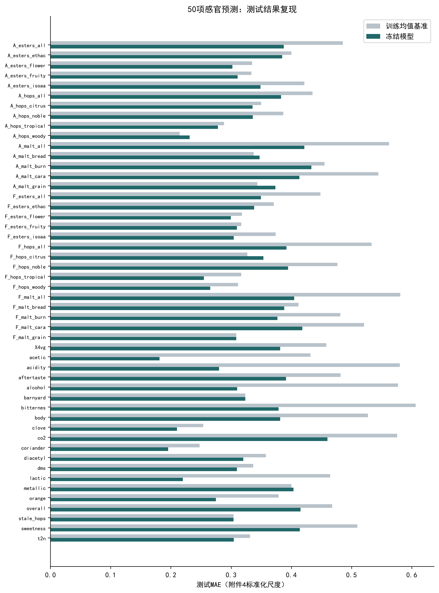
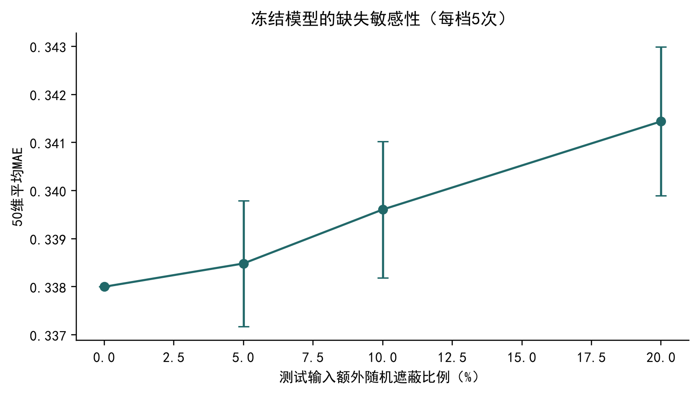
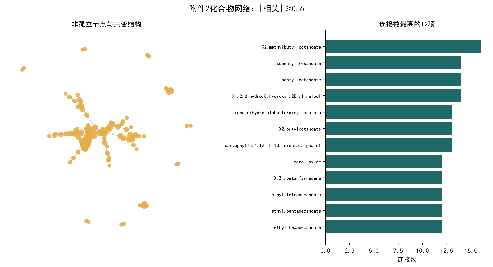
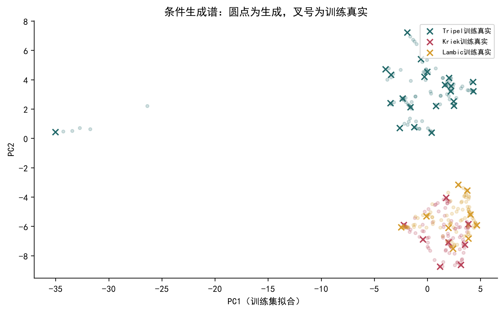
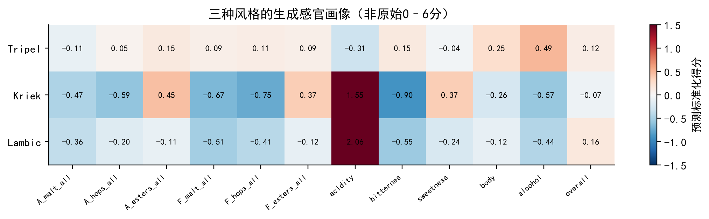
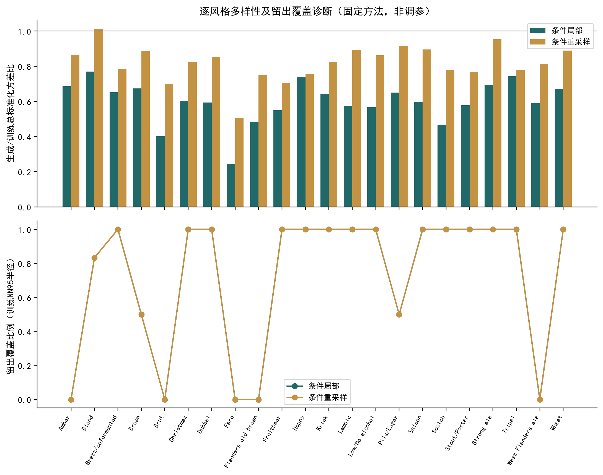
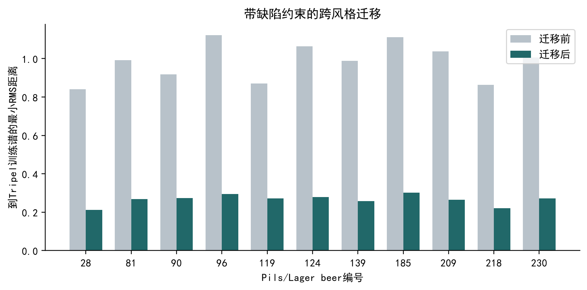

# 混合尺度啤酒数据的感官预测、化合物网络与受约束风味谱生成

审核稿 v2；评分校准及部分阈值仍待主办方确认。酿造/因果实验属研究局限，并非已给题面的额外硬性提交条件。

## 摘要

针对啤酒化合物与感官数据混合尺度、真实缺失和样本较少的问题，建立“尺度核验—冻结预测—关联证据—条件谱生成—约束迁移”的分析流程。实际附件包含250款啤酒、231个化学/理化输入和50个感官目标，与题面若干描述存在差异，本文按文件证据处理。
问题1沿用既有训练集交叉验证选择的模型，逐项复现原测试预测。50维平均测试MAE由0.4120降至0.3380，42维优于均值基准。另给出12500条逐啤酒逐维的样本外预测记录与训练分位数相对0–6级。由于原始评分和逆变换参数未提供，不能将相对等级认定为原始0–6分恢复。
问题2发现附件2与重算Spearman矩阵的最大差异仅6.66×10^-16。采用218个单项测量候选构建网络（245条边），对全部50维给出150条Top-3证据，200轮bootstrap中19条入选频率不低于80%。同时报告风格调整、来源与气味证据，避免把相关当作因果。
问题3以训练样本构成风格条件局部生成分布，为22种风格各生成100条谱及对应感官画像。在11款Pils/Lager向Tripel的约束迁移中，11款找到目标距离下降的可行候选，四个缺陷原生字段保持不变，Stale hops辅助代理不升高。生成谱是混合尺度下的统计候选，尚未经过酿造或盲评验证；缺失阈值和原始评分校准仍构成提交限制。
关键词：啤酒风味；尺度核验；相对等级；Spearman网络；条件生成；约束迁移。

本轮审核在不含v1派生结果的干净副本内重新训练、重建网络、生成、迁移、构建材料及验证；冻结输入边界见附录B与复现说明。辅助Stale hops模型未优于均值基准，因此只报告模型代理条件，不作实际缺陷保证。实际酿造和因果实验未被给定题面列为强制提交条件，本版本将其列为研究局限。

## 1 问题分析与任务口径

第一问要求以附件1给出附件3定义的Aroma与Flavour维度0–6分级。实际评分卡包含Aroma 15维、Flavour 15维，另有20个感官项目，合计50维。本文核心分析覆盖30个A/F目标，并将全50维结果作为完整补充。题面“约40维”不能用来随意删除或增造维度。
第二问要求利用附件2建立化合物网络，并给出每个感官维度的Top-3与稳定性、化学合理性。统计关联能发现候选因素，但同源代谢和风格均可能造成混杂；关键因素在本文指关联候选，不等于已经证实的单体作用。
第三问要求按tasting_category_fine生成合理化合物谱、感官画像和跨风格迁移，并保持缺陷不恶化。样本分布不均，风格仅3–31款，因此选择可审计的小样本局部生成分布，给出分布与多样性诊断。谱生成、物理浓度配方和实际酿造可行性是不同证据层次。
赛题另要求完整论文、清晰量化图表、可复现源码。本文保留原有文件，所有新产物存入独立目录。未向赛事平台提交；队伍身份和赛事额外格式规范不在当前文件中，需正式提交前核对。

## 2 数据结构、冲突与来源核验

附件1为250×234，去除beer、beer_id和风格后有231个输入；附件4为250×53，含50个标准化连续目标。附件3有beer_1至beer_12和summary共13个sheet，而非题面所述10个。评分模板中的0和公式缓存不是250款啤酒的实际人工评分，禁止据此构造监督标签。附件6实际为44个化学/理化指标×50感官项目，而非题面46；附件7为250×189，去除3列标识后有186个属性，与题面187也不同。
以唯一beer编号对齐，两个表的编号集合与风格逐项一致。附件4的beer_id以低精度科学计数法导出，部分条码数值已损失精度，单独记录到barcode_precision_audit.csv，不以条码猜测修复编号。原有数据、Notebook、输出均保存SHA256清单。
四种重点化合物采用独立核验Notebook的结论。附件8声明DMS单位ug/L；双乙酰、4VG、反式-2-壬烯醛单位mg/L。DMS与4VG的附件8正浓度分别249和82条，在附件1中符合log10，误差不超过5×10^-10。两列分别1和168个零值，在附件1对应固定有限值，逆log10约为最小正浓度的一半。这支持某种零值替代预处理，但不能证明零值是绝对零、未检出或缺失。
双乙酰241条共同非缺失记录中238条原值对应；beer156、34、151分别为附件1/8的0.434130/0.123114、0.289622/0.530466、0.139752/0.043173。另9个附件1缺失位置在附件8均为0，本文视为来源冲突而非已知零。beer73在两附件均约121.731018 mg/L，且源格为数字；一致不能证明测量真实性，因此不删行、不改单位、不缩尾原数据。既有岭回归内部的训练分位数裁剪属于模型预处理，不改变原文件。
反式-2-壬烯醛的249条共同有效值中247条原值匹配；beer158、130数值有差异，177在附件8缺失。其阈值mean与median均缺失。附件8三项既有19、0.09、0.20分别是DMS、双乙酰、4VG的threshold_median，而不是本项目实验确证的风格特异缺陷界限。Stale hops是感官描述，附件中没有同名的单一化合物浓度阈值。
进一步下载原研究Zenodo v3公开补充表，MD5与站点声明52645e38d90aafda272532e19e2fea1c相同，完整列出29个sheet。其S4仍为同一类标准化评分，S3仍为空白表；其他验证实验为额外处理条件，不能充当全部250款原始配对标签。公开补充资料未解决完整原始0–6标签和逆变换校准问题。原研究确实说明感官分析使用z分数及部分化学量使用对数变换[2–3]。

## 3 问题1：冻结模型与相对分级

3.1 连续预测。沿用random_state=42、按22种风格分层的200/50训练/测试划分，复用原model_selection_cv_50.csv中已冻结的逐目标选择。候选为训练均值基准、带中位数填补和标准化的岭回归、随机森林。既有岭回归先按训练折1%与99%分位数裁剪，alpha=100；森林为200棵树、max_depth=6、min_samples_leaf=5、max_features=0.7。50维选择为42个森林、5个岭回归、3个均值基准，不用新的测试结果继续选模型。
缺失仅在模型输入的副本中按训练子集的列中位数填补，原始数据不改写、不把缺失当0。裁剪界点、填补值、标准化参数均只由相应拟合子集计算。先重建200样本模型，对原50个测试beer逐项对照既有预测文件，允许误差1e-8；全部通过。
3.2 原始评分不可识别。即使假设每个属性满足z=(r-mu)/sigma，未给出mu与sigma也不能唯一反求r。对于当前标准化数值范围，r=3+0.4z与r=2+0.5z都可落入0–6，但彼此不同；假定离散、对个体或对面板汇总标准化，又会带来更多不可逆信息。把观察min/max映射到0/6、整体加常数或四舍五入均不能成为真实还原证据。
3.3 可复现的替代输出。对每个目标在训练子集计算六个分位点q_j=Q(j/7)，j=1,…,6；定义g(z)=sum_j I(z≥q_j)，输出0至6相对等级。等级同分并非原始强度相同，不同目标的等级也不能充当绝对感官单位。每个训练OOF样本的界点仅用该折拟合子集计算，测试界点用全部200个训练样本计算。所有维度的全训练界点均互异；使用side=right处理边界同分。
3.4 评估与局限。训练部分采用5折样本外预测，测试50款复用冻结模型。训练OOF不是无偏的嵌套选择评估，因为原模型选择用过同一训练集；据此得出的残差区间只能作描述性不确定性指示，不能宣称严格90%覆盖保证。区间半宽取OOF绝对残差的90%高阶分位数，不用测试残差调区间。

评分口径复核详见Q1_SCORING_SCOPE.md及q1_score_scale_evidence.json；输出字段actual_relative_grade也是连续标签按训练界点分档，不是原始人工标签。现有资料未发现可靠的原始标签/逆变换，未生成原始0–6分列。

## 4 问题1实验结果

| 数据 | MAE | 基准MAE | R2 | 等级MAE | 分级准确率 | 区间覆盖率 |
| --- | --- | --- | --- | --- | --- | --- |
| 测试 | 0.3380 | 0.4120 | 0.2314 | 1.5420 | 0.2044 | 0.9056 |
| 训练OOF | 0.3442 | 0.4188 | 0.2306 | 1.5740 | 0.2074 | 0.9050 |

测试连续MAE改善17.97%，42/50维改善。相对分级测试MAE为1.542级，基准为1.842级；平均准确率约20.44%，表明七档精细区分仍然困难，不应只展示连续MAE而回避分级误差。50维MAE等权平均，不能解释为所有单项均显著改善。

在测试输入额外独立遮蔽0%、5%、10%、20%观测值，每档5次，模型与预处理固定；结果如下。该试验是MCAR型人为遮蔽，不代表真实非随机缺失，且用作诊断而非据此重新选模。

| 额外遮蔽率 | 平均MAE | MAE标准差 |
| --- | --- | --- |
| 0.0000 | 0.3380 | 0.0000 |
| 0.0500 | 0.3385 | 0.0013 |
| 0.1000 | 0.3396 | 0.0014 |
| 0.2000 | 0.3414 | 0.0015 |

## 5 问题2：化合物网络与稳定因素

按化学字典将231项输入分为单项测量候选、汇总值、理化测量和混合定义待核实项。Top-3仅从218项单项候选中选，避免总酯等汇总量冒充一个分子。附件2经名称映射与希腊字母乱码修正后完整一一对应231项，未随意近似匹配。
对26565个不同指标对，附件2与1.csv重算Spearman的平均绝对差1.59×10^-16、最大6.66×10^-16；与Pearson平均差0.08768，最大1.12343。原研究公开绘图代码也以Spearman计算化学相关[4]。故保留附件2实际语义，并将Pearson作为敏感性比较，而不按错误文字给现成矩阵重新命名。
无向网络以218个候选为节点，|rho|≥0.6为边；得到245条边、120个非孤立节点。本轮从原始附件独立重算100轮网络bootstrap，以相关强度及同号保留率筛选得到172条稳定边，作为边级稳定性补充。连接多只表示共变，不表示化学反应方向或生化通路。
对每个感官目标，成对使用双方均非缺失的样本，要求有效数≥200，按Spearman绝对值取前三。对整行beer重采样200轮，每轮在全218候选中重新排名，定义入选频率f_j=200轮进入Top-3的次数/200。附表另给已选候选相关系数的百分位bootstrap区间，这些区间未校正事后选择，不作为确认性显著性结论。
全50维共150条候选，其中19条入选频率≥0.8、89条低于0.5，提示不少维度的前三排序不稳定。对每对变量的秩值减去各风格组均值，再计算残差相关；143/150条方向一致，其余需要特别警惕风格混杂。这种调整仅移除风格组平均秩差异，不能控制未测混杂。

保留全部150条Top-3，另加candidate_class字段：入选频率≥0.8且风格调整方向一致的19条标为stable_association；频率较低的标为exploratory_association；若排名稳定但方向反转，则单列stable_rank_direction_sensitive。该分类为审阅标签，未据其修改Top-3名单或模型。稳定也不等于因果。

## 6 化学合理性与反证

| target | rank | chemical_name | rho | bootstrap_frequency | style_adjusted_rho |
| --- | --- | --- | --- | --- | --- |
| A_malt_all | 1 | Acetaldehyde | 0.3612 | 0.6000 | 0.0320 |
| A_malt_all | 2 | Methylpyrazine | 0.3561 | 0.5150 | 0.1663 |
| A_malt_all | 3 | Ethanol | 0.3350 | 0.4100 | -0.1027 |
| A_hops_all | 1 | Ethyl octanoate | 0.4637 | 0.7900 | 0.2868 |
| A_hops_all | 2 | E-2-nonenal | 0.4320 | 0.4000 | 0.2296 |
| A_hops_all | 3 | Ethyl decanoate | 0.4277 | 0.4500 | 0.2366 |
| A_esters_all | 1 | N-hexanol | 0.3569 | 0.7500 | 0.2747 |
| A_esters_all | 2 | Acetaldehyde | 0.3530 | 0.6050 | 0.3013 |
| A_esters_all | 3 | Ethyl acetate | 0.3213 | 0.4550 | 0.2381 |

化学论证以附件8的origin_paper、off_flavors和unit为证据，不把名称相似当作已证实机制。麦芽香气前三包含甲基吡嗪（Malt来源），与麦芽相关是有来源支持的候选；乙醛、乙醇属Yeast来源，可能作为发酵或风格共同变化的代理。尤其乙醇与整体麦芽香气的相关由约0.335变为风格调整后约-0.103，不能宣称增加乙醇会增加麦芽香。
整体酯香中的乙酸乙酯有酯类类别与酵母来源支持；乙醛与正己醇则不应仅因统计排名高就称为“酯香因果物质”。酒花整体香气前三中的辛酸乙酯、癸酸乙酯同属酵母相关酯，反式-2-壬烯醛在附件标注为Others且随陈化增加；它们与酒花香气的相关更需要通过风格内与共变网络解释，而不能据此建议添加陈化醛。原研究也提示共线化合物可相互代替成为重要预测因子[2]。
完整q2_top3_all50_evidence.csv逐项列出150条候选的来源、气味记录、单位、原始与调整相关、稳定性和区间。气味字典为空表示没有提供该条文字证据，不自动补造香气描述。论文附录列出全50维前三，供读者逐项复核。

## 7 问题3：风格条件生成模型

7.1 模型。令风格s的训练集为D_s。在训练集列中位数填补、StandardScaler变换后的空间中，建立每个样本的同风格最近邻集合N_k(i)，k=min(5,n_s-1)。先均匀抽锚点i，再均匀抽其近邻j，采样lambda~Beta(1,4)，生成x_tilde=(1-lambda)x_i+lambda x_j。离散风格条件与连续局部核共同定义p_hat(x|s)。不是声称训练了VAE或GAN；这是可审计的经验条件生成模型。
缺失仅在距离计算副本中填补。生成的原生谱若某输入在任一父样本缺失，则该坐标保持缺失，并保存父beer和lambda。完整谱可由训练父样本与lineage重建。已观测坐标位于父样本区间，故不会超出全训练范围；原生非负物理参数也不会因线性插值产生负值。log10坐标上的插值对应浓度的几何路径，原值坐标对应算术路径。对变换尚未核实的字段只声明原生尺度，不自动逆变换。
这项构造限制外推，但也会压缩方差、遗漏稀有模态。汇总指标同样做统计插值，尚未证明满足物理守恒或汇总恒等式，因此输出不能直接称为可投产配方。原生谱与真实浓度、合法配料、发酵工艺之间仍需实验校验。
7.2 固定验证。生成规则在看验证数值前固定，训练仅使用原200款；一次性在50款留出样本上比较条件局部生成、同风格直接重采样、无条件局部生成。后两者是基线，不用于测试调参。每风格至少一个留出样本，部分只有1–2个，因此按风格等权的统计很不稳定，不作显著性优越宣称。
指标包括训练尺度的逐维一维Wasserstein距离、均值RMS偏移、生成点到训练谱最近距离、精确重复比例、训练范围外比例与缺失率。网络保真度以既有稳定边在各风格真实训练谱与生成谱中的Spearman差异衡量；它是拟合检查，不是独立泛化证明。单独固定一个风格分类器作诊断，其测试准确率约60%，说明类别本就重叠；生成条件一致率不能等同感官真实性。

## 8 条件生成实验结果

共为22种风格各生成100条，即2200条231维原生谱；每条配50维冻结模型预测与相对分级，保留原生坐标、谱血缘和预测输出，不添加伪造的样本实测标签。

| 方法 | 边际W距离 | 最近训练距离 | 精确重复率 | 训练范围外比例 | 生成缺失率 |
| --- | --- | --- | --- | --- | --- |
| 条件局部 | 0.7479 | 0.2104 | 0.0000 | 0.0000 | 0.0018 |
| 条件重采样 | 0.7598 | 0.0000 | 1.0000 | 0.0000 | 0.0011 |
| 无条件局部 | 0.8298 | 0.1806 | 0.0000 | 0.0000 | 0.0021 |

条件生成的逐维Wasserstein均值为0.7479，无条件基线为0.8298。直接重采样精确重复率100%，局部模型为0%；但局部生成到训练集平均最近距离仅0.2104，明显低于真实留出样本的2.4572，提示覆盖不足与近训练集生成，而不是充分学习整个风格分布。
固定风格诊断器的留出准确率60.0%，平衡准确率55.3%；生成谱条件一致率98.95%。后者接近100%部分源于局部生成与训练谱接近，不证明新颖风格创造成功。Tripel、Kriek、Lambic的网络边相关平均差如下。

| style | absolute_difference |
| --- | --- |
| Kriek | 0.0818 |
| Lambic | 0.1099 |
| Tripel | 0.0554 |

q3_style_sensory_profiles.csv给出每个风格、每个目标的预测均值及5%–95%生成分位数。该区间表示模型内生成变化，不含完整预测误差，也不是95%置信区间。图中的酸度、酒花或酯香差异是标准化预测，不能标记为真实0–6分。

### 逐风格多样性和覆盖（新增审核诊断）

方差使用原生观测值、ddof=1，不用缺失填补结果假装方差。总方差先按训练集尺度归一化，再计算生成/同风格训练方差比；恒定/缺失列按CSV中的有效列数说明。距离在同一个训练拟合的填补、标准化空间计算。覆盖半径取同风格训练点留一最近邻距离的95%分位数，留出点到生成集合距离不超过该半径即计覆盖。该经验半径不是置信保证，尤其小风格样本时不能作概率解释。未用这些新增诊断重新选择方法或超参数。

| 风格 | 训练数 | 留出数 | 局部方差比 | 重采样方差比 | 局部留出覆盖 |
| --- | --- | --- | --- | --- | --- |
| Amber | 10 | 2 | 0.6868 | 0.8657 | 0.0000 |
| Blond | 25 | 6 | 0.7703 | 1.0136 | 0.8333 |
| Brett/cofermented | 5 | 1 | 0.6512 | 0.7851 | 1.0000 |
| Brown | 10 | 2 | 0.6731 | 0.8870 | 0.5000 |
| Brut | 3 | 1 | 0.4019 | 0.6996 | 0.0000 |
| Christmas | 7 | 2 | 0.6031 | 0.8239 | 1.0000 |
| Dubbel | 8 | 2 | 0.5941 | 0.8550 | 1.0000 |
| Faro | 2 | 1 | 0.2429 | 0.5048 | 0.0000 |
| Flanders old brown | 4 | 1 | 0.4833 | 0.7488 | 0.0000 |
| Fruitbeer | 6 | 2 | 0.5503 | 0.7047 | 1.0000 |
| Hoppy | 14 | 3 | 0.7370 | 0.7566 | 1.0000 |
| Kriek | 8 | 2 | 0.6430 | 0.8248 | 1.0000 |
| Lambic | 9 | 2 | 0.5728 | 0.8927 | 1.0000 |
| Low/No alcohol | 6 | 2 | 0.5668 | 0.8617 | 1.0000 |
| Pils/Lager | 9 | 2 | 0.6499 | 0.9157 | 0.5000 |
| Saison | 8 | 2 | 0.5973 | 0.8959 | 1.0000 |
| Scotch | 4 | 1 | 0.4683 | 0.7801 | 1.0000 |
| Stout/Porter | 10 | 3 | 0.5773 | 0.7682 | 1.0000 |
| Strong ale | 14 | 4 | 0.6939 | 0.9540 | 1.0000 |
| Tripel | 22 | 6 | 0.7427 | 0.7811 | 1.0000 |
| West Flanders ale | 6 | 1 | 0.5894 | 0.8133 | 0.0000 |
| Wheat | 10 | 2 | 0.6712 | 0.8892 | 1.0000 |

留出样本不足2款的风格，其方差字段保留NA而非0。q3_style_diversity_coverage.csv逐风格逐方法共66行，包含训练/留出数、方差、生成对距离、同风格训练距离、留一距离与覆盖；与条件重采样、无条件基线一并提供。

逐风格等权平均下，局部生成/训练方差比为0.5985，重采样为0.8192；留出覆盖分别为0.7197和0.7197。这组诊断表明局部生成有方差收缩，未显示对条件重采样的覆盖优势；不据此反复调参或声称生成已充分覆盖真实分布。

## 9 跨风格迁移与缺陷约束

对11款Pils/Lager样本，将目标锚点限制为训练集Tripel谱，枚举alpha∈{0.25,0.5,0.75}的原生插值，并加入alpha=0原谱候选。上限0.75用于至少保留25%源坐标，避免完全替换为目标供体。四个缺陷坐标DMS、双乙酰、4VG、反式-2-壬烯醛在插值后恢复为源值，包括缺失状态。
在可行候选中最小化“到最近Tripel训练谱的标准化RMS距离+0.1×改动RMS”。系数是明确的设计取值，未用测试评分调节。源缺失值不凭空补全，因此仍有部分坐标未知。全部候选、可行性、目标距离与最后选择保存在search_frontier表，不仅展示成功样本。
对四项已知缺陷坐标，原值完全保持是比固定上阈值不增更强的单调约束：若同一可靠单调逆变换成立，则任意同一阈值下max(C-tau,0)不变。它不使已有超阈值缺陷消失，也不能证明未知缺失安全。对于双乙酰来源冲突，本次选择题面指定的附件1作为生成主坐标，附件8只作独立校验，不覆盖冲突。迁移保持的是附件1测量表征，不是在声称解决了实验真值。
原冻结Stale hops预测器为常数均值模型，其不升高约束本身没有区分力。为避免空约束，另用预先固定的森林配置只在200款训练数据拟合辅助Stale hops代理，并要求其预测不高于源谱。这不是根据测试成绩重选第一问模型，原模型与其结果保持不变。辅助代理5折训练CV平均MAE为0.3127，均值基准为0.3120，平均R2为-0.1172，表现较弱。因而只能称“代理约束满足”，不称“陈旧酒花缺陷实测不恶化”；非恒定辅助约束仅提供模型层面的条件，未解决预测可信度问题。附件没有该描述的单一浓度阈值，也不编造。
11/11款找到可行距离改进；平均相对距离改善72.99%。训练源样本与留出源样本在summary中分开标注，所有目标供体均来自训练集。该结果是对固定代理和距离目标的优化演示，不是11项独立生产验证，也不把优化后的模型预测当成实验结果。

| 源beer | 迁移强度 | 距离相对改善 | Stale代理前 | Stale代理后 |
| --- | --- | --- | --- | --- |
| 28 | 0.7500 | 0.7472 | 0.1903 | 0.0374 |
| 81 | 0.7500 | 0.7294 | 0.5455 | 0.1323 |
| 90 | 0.7500 | 0.7024 | -0.0835 | -0.0924 |
| 96 | 0.7500 | 0.7373 | 0.1101 | -0.1788 |
| 119 | 0.7500 | 0.6885 | 0.0339 | -0.1778 |
| 124 | 0.7500 | 0.7381 | -0.0779 | -0.1935 |
| 139 | 0.7500 | 0.7396 | -0.0917 | -0.1454 |
| 185 | 0.7500 | 0.7288 | -0.0209 | -0.2042 |
| 209 | 0.7500 | 0.7443 | -0.0941 | -0.1984 |
| 218 | 0.7500 | 0.7436 | 0.2083 | -0.0684 |
| 230 | 0.7500 | 0.7301 | 0.0906 | -0.1759 |

### 四种缺陷的证据状态

| 字段 | 原生已知 | 原生缺失 | 附件8缺失 | 缺失状态差异 | 数值冲突 | 零含义未知 | 阈值未知 |
| --- | --- | --- | --- | --- | --- | --- | --- |
| DMS | 250 | 0 | 0 | 0 | 0 | 1 | 0 |
| X2.3.butanedione | 241 | 9 | 0 | 9 | 3 | 9 | 0 |
| X4VG | 250 | 0 | 0 | 0 | 0 | 168 | 0 |
| X.E..2.nonenal | 250 | 0 | 1 | 1 | 2 | 0 | 250 |

这些标记可重叠，不能加总为互斥风险类别。DMS/4VG原生有限值不代表附件8零值含义已确定；双乙酰9处缺失/零冲突与3处数值差异分别统计；trans-2-nonenal还有1处缺失状态差异和2处数值冲突，阈值全部未知。迁移对应的44条证据在q3_transfer_defect_evidence.csv，逐条保留原生已知/缺失、来源差异与阈值标记，不能把缺失冻结视为安全证明。

辅助Stale hops五折MAE差（模型减基准）为0.000660，仅2/5折较优，没有显示平均MAE优势。它没有获得实际安全约束资格；所有满足表述限于“模型代理约束”，不能由优化后预测值降低推出实际陈旧酒花缺陷降低。

## 10 鲁棒性、可复现性与局限

第一，所有源文件建立哈希清单，旧Notebook、CSV与GraphML均保留。关键标识使用beer而非顺序或精度损失的条码。独立核验Notebook保留四种化合物的原始Excel格地址、类型、格式和批注检查；本次新增材料不篡改该历史记录。
第二，冻结原模型选择；训练OOF与原测试结果清晰分开。该测试集在历史工作中已被查看，当前复现不是一批全新盲测，不能夸大其独立性。新增缺失试验不用于模型挑选。生成规则固定后报告三种方法结果，不因为留出表现继续挑选生成超参数。迁移辅助代理的设计针对常数约束这一结构性缺陷，不以留出感官成绩选择。
第三，Top-3稳定性在全部候选中重排名，避免只对原始前三做自我确认。风格调整提供混杂敏感性，Pearson与Spearman的Top-3 Jaccard表提供统计定义变化下的敏感性。这里只是探索性分析；未做独立新样本验证、未控制多重选择后的推断误差。
第四，生成器受限于小样本、同风格支持和局部核，范围内不等于化学合理。PCA二维图也不能证明高维分布等价。近训练距离、相关差异和缺失率均如实报告，不能仅凭漂亮风味指纹宣称优越。需要以新啤酒、重复检测与盲评检验泛化。
第五，真正满足原始0–6分要求仍需原始面板标签、对应标准化方式及参数，或组织方批准相对等级口径。缺陷阈值需明确检测单位、风格背景与实验依据；反式-2-壬烯醛、Stale hops的阈值未解决。本论文给出的保守不增设计缓解阈值缺失，但不取代完整缺陷判定。

### 汇总指标与组分一致性

对题面提及的总酯、酒花香气、总酸、硫化合物和热量五项重新检查附件8元数据、公开补充表方法记录及变换配对。没有找到足以同时确认组分清单、系数、单位换算及变换顺序的完整链条。因此五项均标“未验证”，consistency_error为NA，recomputed=False；不猜sum公式，也不重写生成汇总列。kcalperc虽有单位kcal%，也不能据此推导能量公式。

| 汇总字段 | 附件单位 | 组分一致性 | 已重算 |
| --- | --- | --- | --- |
| esters_sum | NA | 未验证 | False |
| aroma_hops_sum | NA | 未验证 | False |
| acids_sum | NA | 未验证 | False |
| sulfur_sum | NA | 未验证 | False |
| kcalperc | kcal% | 未验证 | False |

统计谱合理性仅由范围、多样性、距离、相关结构等模型诊断支持；感官画像是冻结模型预测；实际酿造有效性本项目未测。分类器一致率与优化目标变化不是感官或酿造实测。酿造和因果实验属于研究局限，而非给定题面额外列出的必须完成提交条件。

## 11 结论与建议

本项目已经形成可复现的三问研究实现：50维标准化预测复现、12500条样本外相对分级记录、150条带稳定性与来源的Top-3证据、官方矩阵网络、2200条风格条件生成谱及11款跨风格迁移。测试MAE为0.3380，相较均值基准改善约18%；化合物关联中只有19/150条达到80%入选稳定性，不能笼统宣称所有前三可靠。
优先建议补齐原始评分校准和有冲突的化合物实验记录；针对高值与零值做来源复核，而不是删行或按猜测换单位。在可确定单位的化合物上开展定量检测，建立风格特异感知/缺陷实验；最后以盲评和小试酿造验证生成与迁移。当前交付可作为审核研究稿和支撑材料，但不应标记为“全部硬要求已验证满足”的最终提交版。

## 参考文献与数据来源

[1] 2026年MathorCup数学应用挑战赛大数据竞赛，赛道A初赛题面，项目data目录PDF，3页；附件1–8及数据说明。
[2] Schreurs M, Piampongsant S, Roncoroni M, et al. Predicting and improving complex beer flavor through machine learning. Nature Communications, 2024, 15:2368. DOI:10.1038/s41467-024-46346-0. https://pmc.ncbi.nlm.nih.gov/articles/PMC10966102/
[3] Schreurs M, et al. Data from: Predicting and improving complex beer flavor through machine learning, Zenodo v3. DOI:10.5281/zenodo.10653704. https://zenodo.org/records/10653704 。下载文件名Supplemental Files and Figure source files.xlsx，MD5见来源核验记录。
[4] 同一Zenodo记录的Main Figure Generator.Rmd，化学相关表生成部分，方法明确为Spearman。https://zenodo.org/records/10653704/files/Main%20Figure%20Generator.Rmd?download=1
访问日期：2026-10-26。本文未导入Kaggle数据、未执行外部作者脚本、未载入外部预训练pickle，外部资料仅用于溯源。

## 附录A 全部50维Top-3与稳定性

以下数值为200轮入选频率，不是因果置信概率。完整来源和调整相关见配套CSV。

| target | Top1 | Top2 | Top3 |
| --- | --- | --- | --- |
| A_malt_all | Acetaldehyde (0.60) | Methylpyrazine (0.52) | Ethanol (0.41) |
| A_malt_grain | Terpinen-4-ol (0.60) | Beta-phellandrene (0.48) | Isoborneol (0.17) |
| A_malt_bread | Glycerol (0.33) | Ethanol (0.32) | Terpinen-4-ol (0.23) |
| A_malt_cara | Acetaldehyde (0.64) | 2-ethyl-1-hexanol (0.27) | Ethanol (0.31) |
| A_malt_burn | Isobutanol (0.29) | Diethyl sulfide (0.35) | Ethanol (0.27) |
| A_hops_all | Ethyl octanoate (0.79) | E-2-nonenal (0.40) | Ethyl decanoate (0.45) |
| A_hops_citrus | Citronellol (0.59) | Humulene epoxide II (0.46) | Linalool (0.32) |
| A_hops_tropical | Dimethyl sulfide (0.75) | 3-furanmethanol (0.38) | Methyl geranate (0.18) |
| A_hops_noble | Ethyl octanoate (0.89) | Ethyl decanoate (0.85) | E-2-nonenal (0.45) |
| A_hops_woody | Trans-dihydro-α-terpinyl acetate (0.28) | α-calacorene (0.20) | Ethyl tetradecanoate (0.21) |
| A_esters_all | N-hexanol (0.75) | Acetaldehyde (0.60) | Ethyl acetate (0.46) |
| A_esters_ethac | Ethyl acetate (0.58) | Acetaldehyde (0.39) | Ethanol (0.33) |
| A_esters_isoaa | N-hexanol (0.93) | Isoamyl acetate (0.72) | Isoamyl alcohol (0.24) |
| A_esters_flower | Beta-phellandrene (0.24) | Isobutyl acetate (0.23) | Alpha-terpineol (0.17) |
| A_esters_fruity | Beta-phellandrene (0.48) | Eugenol (0.26) | Lactic acid (0.17) |
| F_malt_all | Ethanol (0.97) | Acetaldehyde (0.94) | Methanethiol (0.21) |
| F_malt_grain | Isoborneol (0.43) | Terpinen-4-ol acetate (0.32) | E-β-ionone (0.29) |
| F_malt_bread | Acetaldehyde (0.52) | Ethanol (0.51) | Glycerol (0.48) |
| F_malt_cara | Acetaldehyde (0.97) | Ethanol (0.83) | Ethyl butyrate (0.15) |
| F_malt_burn | Ethanol (0.91) | Methanethiol (0.78) | Glycerol (0.40) |
| F_hops_all | Ethyl octanoate (0.76) | E-2-nonenal (0.37) | Ethyl decanoate (0.30) |
| F_hops_citrus | Humulene epoxide II (0.30) | Ethyl furoate (0.36) | Furfural (0.35) |
| F_hops_tropical | Geraniol (0.56) | Hexyl acetate (0.45) | Dimethyl sulfide (0.42) |
| F_hops_noble | Ethyl octanoate (0.94) | Ethyl decanoate (0.58) | Ethanol (0.37) |
| F_hops_woody | Ethyl tetradecanoate (0.42) | Ethyl decanoate (0.36) | Humulene epoxide II (0.23) |
| F_esters_all | Acetaldehyde (0.75) | Ethyl acetate (0.69) | N-hexanol (0.55) |
| F_esters_ethac | Ethyl acetate (0.97) | Ethanol (0.88) | Glycerol (0.60) |
| F_esters_isoaa | N-hexanol (0.77) | Isoamyl acetate (0.53) | Acetaldehyde (0.18) |
| F_esters_flower | Beta-phellandrene (0.59) | Isopentyl butanoate (0.27) | Terpinolene (0.14) |
| F_esters_fruity | Diethyl sulfide (0.72) | Acetic acid (0.32) | Humulene epoxide II (0.25) |
| body | Ethanol (1.00) | Glycerol (0.69) | Ethyl hexanoate (0.36) |
| bitternes | Ethyl octanoate (0.95) | Ethyl decanoate (0.77) | Methanethiol (0.22) |
| co2 | Ethyl octanoate (1.00) | Ethanol (0.90) | Ethyl hexanoate (0.51) |
| aftertaste | Ethanol (0.78) | Ethyl octanoate (0.65) | E-2-nonenal (0.51) |
| alcohol | Ethanol (1.00) | Glycerol (0.53) | Ethyl octanoate (0.47) |
| sweetness | Ethyl decanoate (0.72) | Pentyl octanoate (0.50) | Iron (0.40) |
| acidity | Prenyl isobutyrate (0.60) | Ethyl phenylacetate (0.51) | Perillyl acetate (0.41) |
| dms | Terpinen-4-ol (0.23) | E-nerolidol (0.17) | Car-3-en-2-one (0.11) |
| metallic | Ethyl 3-methylbutyrate (0.37) | Iron (0.25) | Methyl heptenone (0.24) |
| X4vg | 4-vinylguaiacol (0.90) | Terpiryl acetate (0.45) | Neryl formate (0.29) |
| t2n | Beta-phellandrene (0.30) | Terpinen-4-ol (0.20) | Geraniol (0.20) |
| diacetyl | Eugenol (0.63) | Ethyl decanoate (0.41) | α-calacorene (0.36) |
| stale_hops | 2-undecanol (0.52) | Allo-aromadendrene epoxide (0.39) | Neryl formate (0.28) |
| orange | Camphor (0.84) | Limonene (0.36) | Ethanol (0.39) |
| coriander | 2-methyl-benzofuran (0.23) | Ocimenone (0.21) | Terpinen-4-ol (0.17) |
| clove | Limonene (0.89) | Eucalyptol (0.29) | Camphor (0.14) |
| lactic | Lactic acid (0.47) | Perillyl acetate (0.54) | Prenyl isobutyrate (0.37) |
| acetic | Prenyl isobutyrate (0.68) | Ethyl 3-methylbutyrate (0.51) | Ethyl phenylacetate (0.40) |
| barnyard | 2-undecanol (0.41) | Neryl formate (0.41) | Allo-aromadendrene epoxide (0.31) |
| overall | Ethyl acetate (0.80) | Ethyl octanoate (0.36) | Isoamyl acetate (0.29) |

## 附录B 复现与AI使用说明

本轮推荐入口为python scripts/run_review.py。完整计算从原始附件及frozen_inputs的冻结输入冷启动重算，不读取历史v1训练模型或派生结果。不能把它称为仅从附件即可重做全部历史选模：model_selection_cv_50.csv是冻结的训练CV选择；test_predictions_50.csv只用于历史预测等价性检查；公开补充xlsx只供溯源。角色表、名称映射与网络bootstrap现已从附件重建。详见REPRODUCIBILITY.md。

原始哈希使用历史期望值，不为通过验证而重建；v2路径统一为POSIX相对路径，读取器兼容旧反斜杠键。只有可由同一UTF-8文本的LF/CRLF转换严格解释的变化才标记eol_only，内容修改一律失败。当前工作区35项旧清单均精确匹配；模拟换行和篡改测试分别验证允许和拒绝路径。

06–08旧Notebook保留为v1结果复查；v2在本输出review_notebooks中重新生成并执行的副本仍然是结果复查，不承担完整训练。02和04仅有空白单元格，保留为历史占位，不能作为训练入口。

完整源代码包含训练、生成、审计、验证、干净副本重跑和带时间戳打包。运行日志、环境、输入哈希、验证证据随材料保存。字体可用--font或MATHORCUP_CJK_FONT指定；缺少有效中文TrueType字形时直接给出可操作错误。

AI实际参与了代码、分析解释与材料草拟。当前可提供本轮程序日志和变更，仓库中未发现完整逐轮历史交互导出；不得补造对话或人工工作。若正式规则要求完整AI交互记录，应由队伍提供真实导出并核对声明，当前列为待补/待核对材料。
